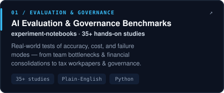
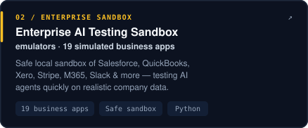
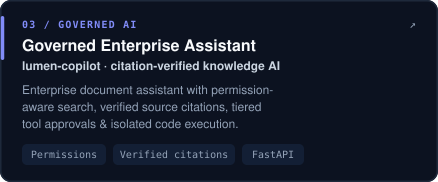
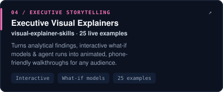
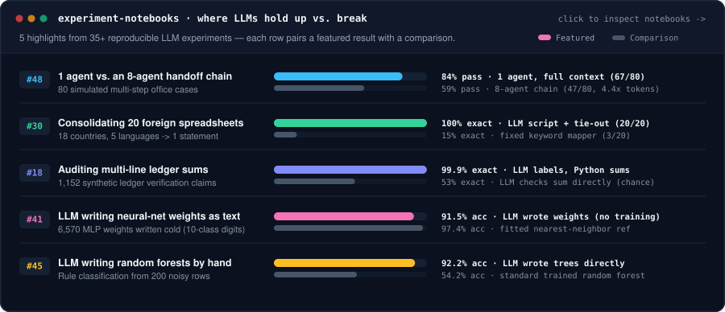

  <picture>
    <source media="(prefers-color-scheme: dark)" srcset="./assets/banner-dark.svg">
    <source media="(prefers-color-scheme: light)" srcset="./assets/banner-light.svg">
    
  </picture>

An open-source lab testing practical questions on real business work: **where can AI genuinely create value today, where does it still break down, and what guardrails are needed before trusting it with real operations?**

> **New here or non-technical?** Start with the [**Interactive Visual Explainers Gallery →**](https://k-sandhu.github.io/visual-explainer-skills/) — short, animated walkthroughs you can read on a phone, with no code required.

---

### Core Focus Areas

  <a href="https://github.com/k-sandhu/experiment-notebooks"><picture><source media="(prefers-color-scheme: dark)" srcset="./assets/cards/experiment-notebooks-dark.svg"><source media="(prefers-color-scheme: light)" srcset="./assets/cards/experiment-notebooks-light.svg"></picture></a>
  &nbsp;
  <a href="https://github.com/k-sandhu/emulators"><picture><source media="(prefers-color-scheme: dark)" srcset="./assets/cards/emulators-dark.svg"><source media="(prefers-color-scheme: light)" srcset="./assets/cards/emulators-light.svg"></picture></a>
   
  <a href="https://github.com/k-sandhu/lumen-copilot"><picture><source media="(prefers-color-scheme: dark)" srcset="./assets/cards/lumen-copilot-dark.svg"><source media="(prefers-color-scheme: light)" srcset="./assets/cards/lumen-copilot-light.svg"></picture></a>
  &nbsp;
  <a href="https://github.com/k-sandhu/visual-explainer-skills"><picture><source media="(prefers-color-scheme: dark)" srcset="./assets/cards/visual-explainer-skills-dark.svg"><source media="(prefers-color-scheme: light)" srcset="./assets/cards/visual-explainer-skills-light.svg"></picture></a>

  
<b>▶ See a 30-second animated explainer (no code needed)</b> — built with <code>visual-explainer-skills</code>: if an AI coding agent removes its own safety check, does it tell the truth when asked?

   
  

    
  

---

### A Few Surprising Findings from the Lab

*You don't need to read code to follow these — each study tests a real business or reliability question and measures AI head-to-head against a clear baseline. Click the chart to explore the plain-English write-ups.*

  <a href="https://github.com/k-sandhu/experiment-notebooks">
    <picture>
      <source media="(prefers-color-scheme: dark)" srcset="./assets/findings-dark.svg">
      <source media="(prefers-color-scheme: light)" srcset="./assets/findings-light.svg">
      
    </picture>
  </a>

### Also on the Workbench

- [**agent-skill-enterprise-data-ecosystems**](https://github.com/k-sandhu/agent-skill-enterprise-data-ecosystems) — pairs with `emulators` to generate realistic multi-system enterprise SQL databases with lineage and controlled data defects for safe agent testing
- [**indus-valley-script**](https://github.com/k-sandhu/indus-valley-script) — open, source-linked research knowledge base exploring how humans and AI agents can collaborate in parallel on an undeciphered ancient script
- [**vannor**](https://github.com/k-sandhu/vannor) — open-source on-premise anti-money-laundering (AML) reference prototype covering sanctions screening, watchlists, case workflows, and transaction monitoring

---

  <code>Applied AI &amp; Agents</code> · <code>Evaluation &amp; Governance</code> · <code>Enterprise Sandboxes</code> · <code>Visual Explainers</code> · <code>Python &amp; SQL</code>

